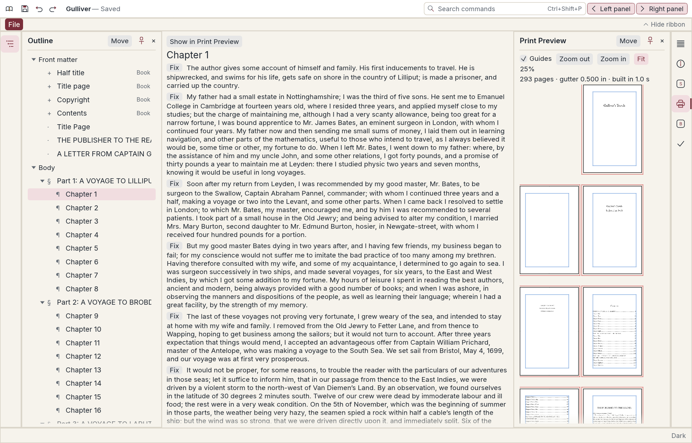
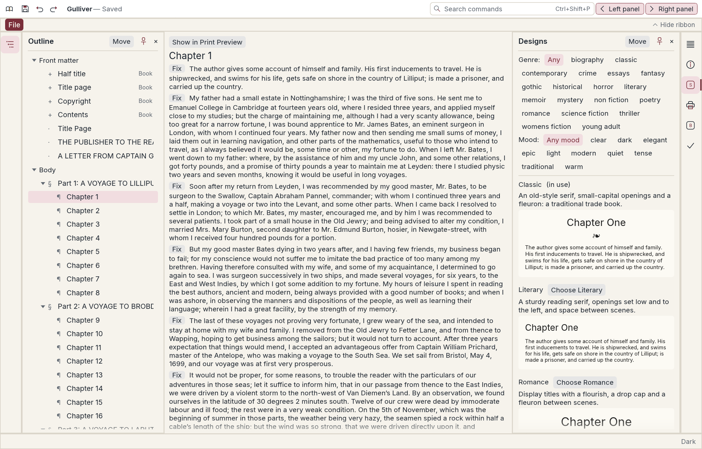
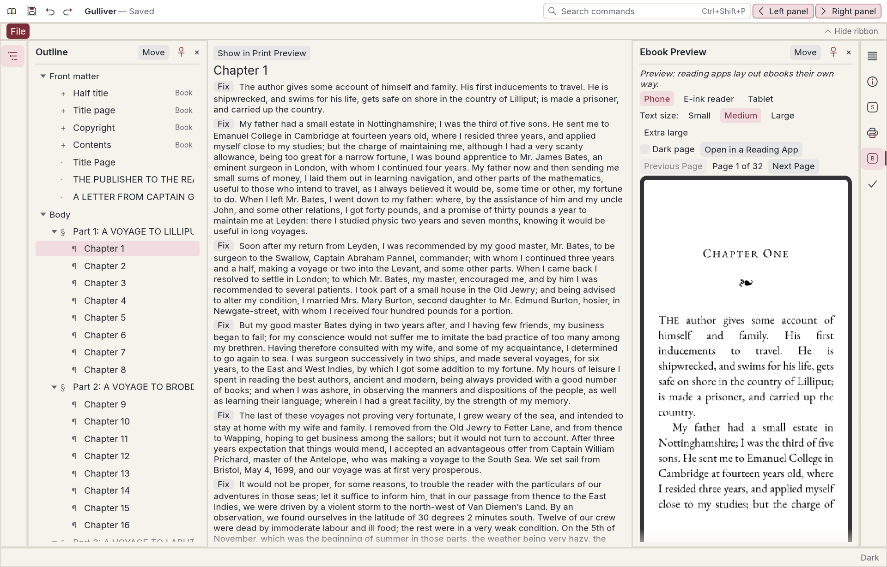
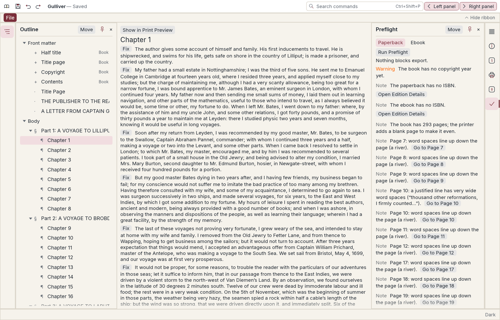
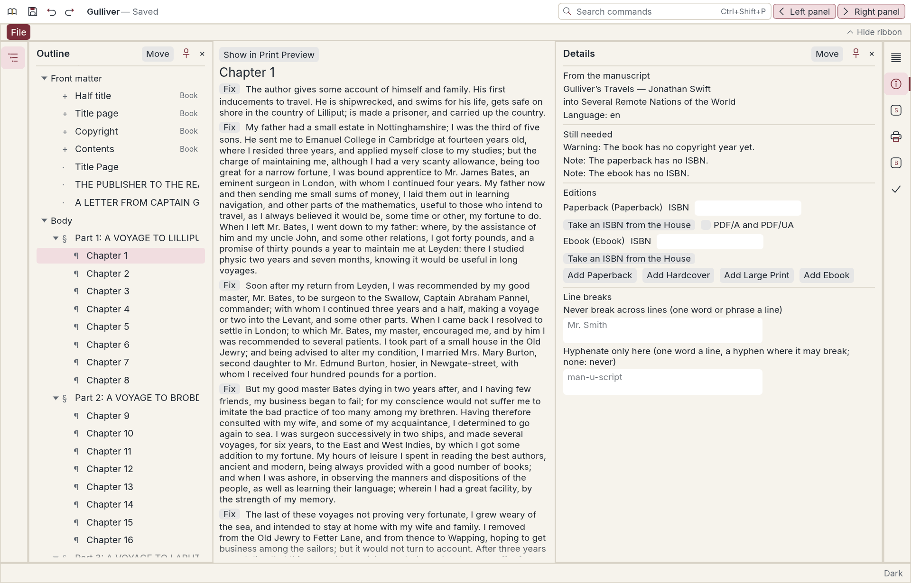
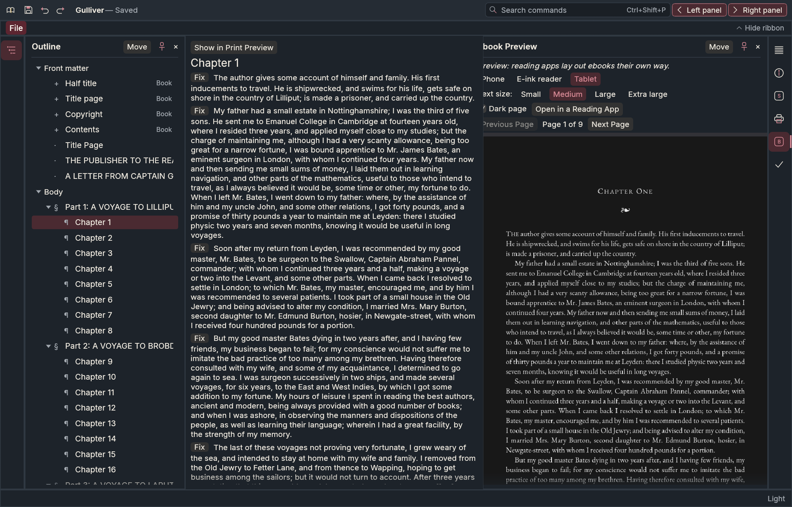

# Wordsmith Book

Licensed under MIT OR Apache-2.0, at your option ([License](#license)).

An open-source app for designing and typesetting books, for macOS, Windows and Linux, written in
Rust. Bring a finished manuscript, pick a book design, set the trim size, chapter openings and
front and back matter, and export a print-ready PDF for a paperback or hardcover and a valid,
accessible EPUB for ebook stores. Every word of both is checked against the source. A book can
link a Wordsmith Manuscript project, which it reads and never changes, or keep a source of its
own imported from a document. A project is a folder of plain-text files that read well in
`git diff`.



## What it does

- **Sources.** Link a Wordsmith Manuscript project, read only (a correction goes back to the
  writer as an offered fix), or import DOCX, ODT, RTF, Markdown, text or EPUB into a source of
  the book's own, with a review before the import and a cleanup of quotes, dashes, spaces and
  stray formatting after it. Re-import a new version of the file and see the differences word by
  word; the design, details and matter are kept.
- **Structure.** Parts and chapters numbered the way you choose; front and back matter made for
  you and placed by convention (half title, title page, copyright, dedication, epigraph,
  contents, "Also by", about the author and more); parts that appear only in print or only in
  the ebook; box sets of several books in one.
- **Designs.** Thirteen built-in designs to filter by genre and mood, each with its fonts,
  chapter openings, scene breaks and running heads, and a large-print variant of any of them.
  Mix two designs, save your own, and share it as a file.
- **Print.** Every common trim size and metric sizes, paperback and hardcover profiles, bleed
  and full-page pictures, footnotes on the page they are called from, asides, and hints for
  words that must not break. A cover template sized from the page count and paper, and a check
  of the cover you bring. PDF/A-2b and tagged PDF/UA-1, and proof PDFs with a watermark and line
  numbers.
- **Ebook.** EPUB 3.3 with accessibility metadata, alternative text, embedded fonts, pop-up
  notes and a page list that matches the print edition. Store editions, each carrying only its
  own links.
- **Checking.** Live print and ebook previews (phone, e-ink reader and tablet, text sizes, a
  dark page). Preflight for each edition, with a button that goes to the page or setting each
  finding is about, typographic warnings by page, and the standard EPUB, accessibility and PDF
  validators when you set them up. Export checks every word, and the same book gives the same
  bytes every time.
- **A publishing house.** One house file a press shares: its imprints, series and ISBNs. House
  designs locked by imprint or series, title and copyright pages from the imprint, a series line
  and "Also by" built from the series, each ISBN checked and used once, and an ONIX for Books 3.0
  record for each edition.
- **Automation.** `book-cli` builds, checks, verifies, converts and reports, and serves every
  command to agents over MCP.

The window has an Outline on the left (front matter, parts, chapters and back matter), panels on
the right (Details, Designs, Print Preview, Ebook Preview, Preflight and Cleanup), a File page for
new, open, import, export and preferences, and in the middle the chosen section's text, with a
Fix button on each paragraph. The interface is in English and Spanish, and every control is named
for screen readers.

| | |
| --- | --- |
|  |  |
|  |  |



The app draws these pictures itself (`cargo xtask screenshots`) from *Gulliver's Travels* (1726),
which is in the public domain, linked as a Wordsmith Manuscript project.

## Getting started

Read the [user guide](docs/guide/README.md). To build and run:

```sh
cargo run --release -p wordsmith-book
```

`rust-toolchain.toml` names the exact Rust release the project builds and ships with (rustup
installs it on first use). The code also builds with Rust 1.95, the minimum supported version.
A first build needs network access to crates.io and to GitHub, where open-source-core, Wordsmith
Manuscript's format crates and their upstream libraries come from (pinned to exact releases). The
command line:

```sh
cargo run --release -p wordsmith-book-cli -- commands
cargo run --release -p wordsmith-book-cli -- convert draft.docx my-book
cargo run --release -p wordsmith-book-cli -- build my-book --out dist
```

`packaging/` holds the release packaging: the desktop entry and file types for Linux, the app
bundle's `Info.plist` for macOS and the file-type registration for Windows. `cargo xtask
third-party-licenses` writes the license text of every shipped dependency.

**Status:** 1.0 is prepared (see [CHANGELOG.md](CHANGELOG.md)) and waits for a maintainer to
approve the first release; no release has been published yet. Print is laid out by the core's
own layout for now, which does not hyphenate words by itself ([decision
0003](docs/decisions/0003-print-typesetting.md)).

### Checking a download

Release files come only from this repository's GitHub releases. Each one has a build provenance
attestation, which shows it was built from this repository by its release workflow. With the
GitHub CLI:

```sh
gh attestation verify wordsmith-book-<version>-<os>-<arch>.tar.gz --repo jamescjfoundation/wordsmith-book
```

## Privacy

- **No telemetry.** The app does not report usage, crashes or anything else.
- **Your books stay on your computer.** Your text, designs, house file and file names are never
  sent anywhere.
- **The update check** is the only request that leaves your computer. When the app starts, and
  when you choose Check for Updates, it asks GitHub's API (`api.github.com`) for this
  repository's list of releases. GitHub sees your IP address and a user agent that names the app
  and its version, nothing else. An update is downloaded only when you choose to install it,
  from the release on github.com.
- **Turning it off:** clear "Check for updates when the app starts" in File › Preferences.
  Nothing is sent unless you then check by hand. `book-cli` never checks.
- **Checking programs** (the EPUB, accessibility and PDF validators) run only when you set one up
  in Preferences, and only on your computer. "Open in a Reading App" hands the ebook to the
  reading app on your computer.

## Working on it

Read [CONTRIBUTING.md](CONTRIBUTING.md) first: this repository is public, and it sets the rules
for personal information, security problems, names and copied code. Report security problems
privately, as [SECURITY.md](SECURITY.md) says.

The app is built on
[open-source-core](https://github.com/jamescjfoundation/open-source-core), the J. C. J.
Foundation's shared base for its desktop apps. The document model, layout, PDF, the command
engine, document import, the window around the views (ribbon, panels, File page, preferences,
updates), translation catalogs and the agent server all come from its `jcj-` crates. It reads
Wordsmith Manuscript projects through
[Wordsmith Manuscript](https://github.com/jamescjfoundation/wordsmith-manuscript)'s published
format crates. This repository holds what is about making books: the book project and its
format, structure and the matter Book makes, designs, print profiles and typesetting, the EPUB
writer, import into a book's own source, preflight and the validators, and the house file and
ONIX. `AGENTS.md` says how a change that belongs in the core is made.

Before merging anything to `main`, run the gate:

```sh
cargo xtask ci
```

It runs rustfmt, the crate-root lint check, a check that no local core link is left, a check that
the settings shared with the core match the pinned core release (`cargo xtask sync --check`), the
layers checks (no upstream crate is named here, and each Book crate uses only the layers under
it), the asset attribution check, the names check, the privacy check, the license allowlist,
clippy and all tests. CI also runs [cargo-deny](https://github.com/EmbarkStudios/cargo-deny) for
licenses, security advisories and crate sources.

- `docs/PLAN.md`: the build plan. `docs/SPEC.md`: the behavior it was built from.
- `docs/format.md`: the project format. `docs/design-format.md`: the design format.
- `docs/decisions/`: the choices the spec left open.
- `docs/golden.md`: the reviewed reference outputs. `docs/fixtures.md`: where every test file
  comes from.
- `docs/requests-to-manuscript.md`: what Book asks of Wordsmith Manuscript.
  `docs/core-candidates.md`: what may move into the core.
- `docs/progress.md`: one line per finished step. `CHANGELOG.md`: what changed.

## Acknowledgments

Wordsmith Book is based on WordCraft by the ArtCraft team. Its document model, page layout,
drawing, PDF output, font handling, command engine and agent connection are WordCraft's, through
[open-source-core](https://github.com/jamescjfoundation/open-source-core); the core's
`docs/UPSTREAM.md` says how.

It is also built on these open-source projects:

- [craft-libs](https://github.com/storytold/craft-libs): PDF reading and writing, file dialogs,
  safe saving and the update check.
- [egui and eframe](https://github.com/emilk/egui) for the window and its controls, with
  [AccessKit](https://github.com/AccessKit/accesskit) for screen readers.
- [zip](https://github.com/zip-rs/zip2) and [roxmltree](https://github.com/RazrFalcon/roxmltree)
  for EPUB and the document formats, [sha2](https://github.com/RustCrypto/hashes) for content
  hashes, and [image](https://github.com/image-rs/image) for pictures.
- The fonts the designs use, listed in `ATTRIBUTION.md`, all under the SIL Open Font License.
- [Wordsmith Manuscript](https://github.com/jamescjfoundation/wordsmith-manuscript), the
  foundation's novel-writing app, whose projects Book reads.
- The public-domain novels the tests and pictures use; `docs/fixtures.md` says where each comes from.

`ATTRIBUTION.md` lists every asset with its license, and `NOTICE` carries the notices the
licenses ask for. `cargo xtask third-party-licenses` writes the license text of every library a
release ships.

## License

Licensed under either of Apache License, Version 2.0 (`LICENSE-APACHE`) or the MIT license
(`LICENSE-MIT`), at your option. Third-party credits are under [Acknowledgments](#acknowledgments).
