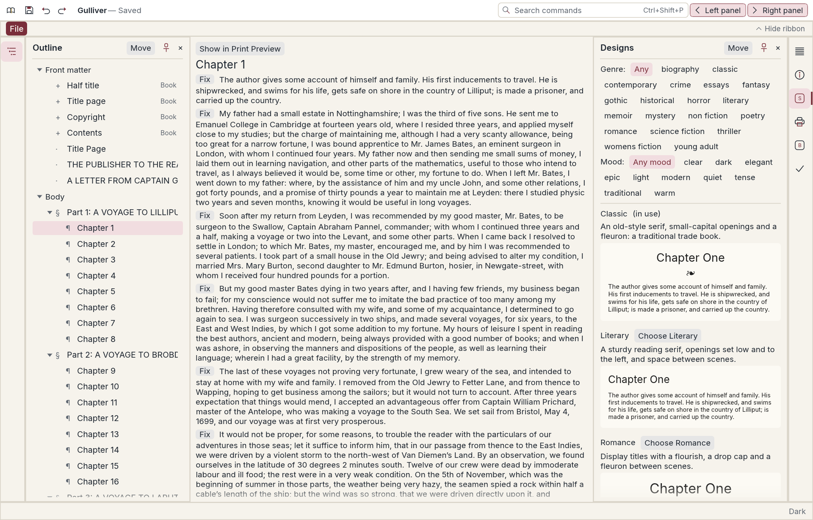

# Designs

A design is data: the body font and size, leading, indents and justification, the
chapter opening (sink, number and title, ornament, first line), scene breaks, part pages, running
heads and folios, and the ebook's choices. Fonts are chosen by role: classic serif, reading serif,
display, display capitals and sans serif.

**Thirteen built-in designs:** Classic, Literary, Romance, Thriller, Fantasy,
Non-fiction, Memoir, Historical, Young Adult, Horror, Cozy, Poetry and Large Print (16-point type,
ragged right), each tagged with the genres and moods it suits.

**Mix and match.** Take one part of another design, such as Fantasy's chapter openings
with Literary's scene breaks, without making a design of your own.

**Your own designs.** Save the book's design as your own, change it, export it as one
file and import it into another book. Book checks a design file before using it.

**The chooser** filters designs by genre and mood and previews each with your own first
chapter. Choosing one is one step to undo.

**Asides.** Letters, notes, signs and messages in the manuscript are set as the design
says for each kind: a letter in italic, a sign centered in small capitals, a message framed in
the sans serif, and so on; a design of your own can change each.
