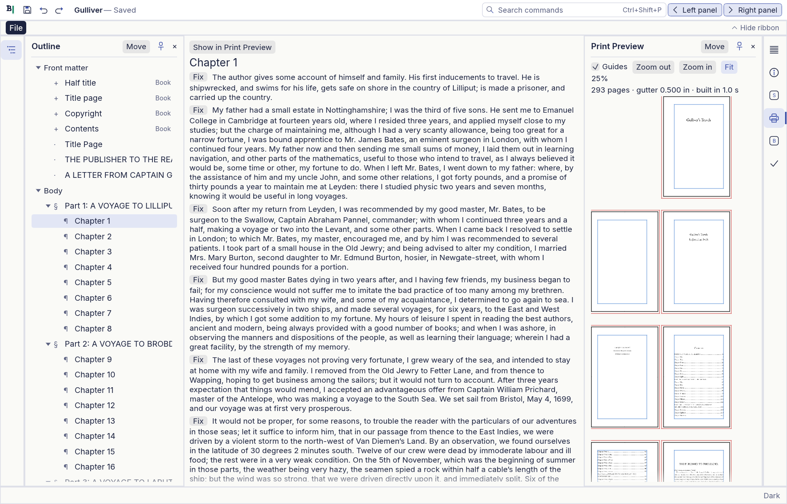
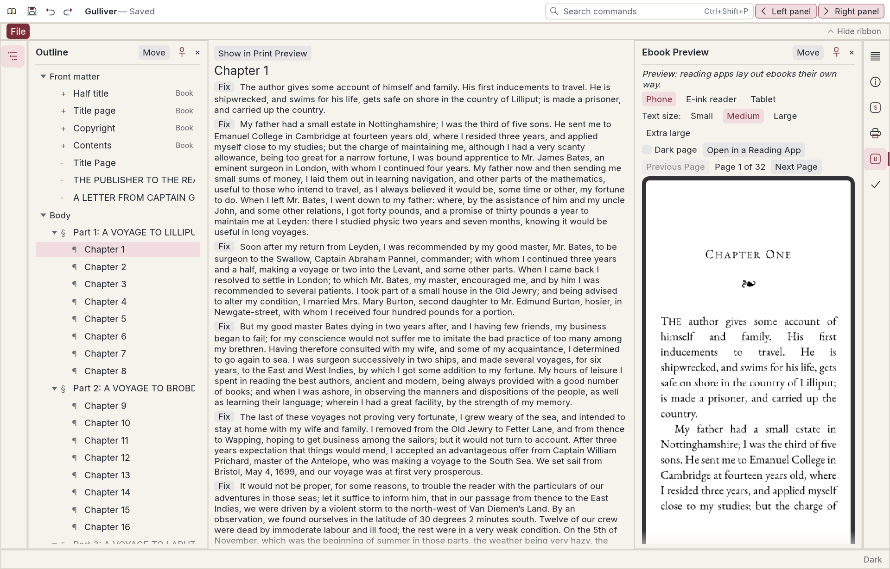
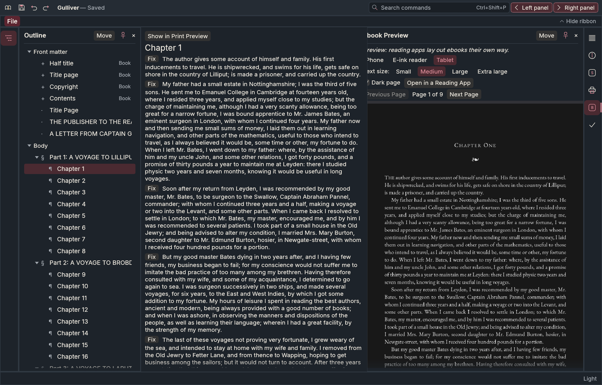
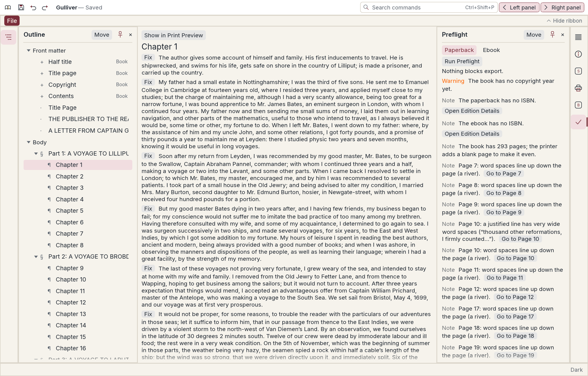

# Previews and preflight

**Print preview.** The Print Preview panel shows the edition as spreads, the first page
alone on the right, with trim, margin and bleed guides you can turn off, and zoom. Click a page to
open its section; choose *Show in Print Preview* on a section to go to its first page. The book is
laid out in the background whenever it changes; the first pages show within a fraction of a
second and the whole book follows.

**Ebook preview.** The Ebook Preview panel lays out the first chapter as the ebook's
styles say, at a phone, e-ink reader or tablet size, with four text sizes and a dark page. It is a
preview: reading apps lay out ebooks their own way. *Open in a Reading App* builds the EPUB and
hands it to the reading app you have installed.

**Preflight.** The Preflight panel builds an edition and reads the built file back. For
print: page size, margins for the page count, fonts embedded and licensed for embedding, the
smallest type, picture resolution (300 pixels per inch or more), blank-page runs, the page count,
annotations and bookmarks, and every letter of the PDF against the book. For the ebook: the
package's structure, alternative text, accessibility metadata, the cover, and every word against
the source. For both: the book details still missing, ISBNs and their check digits, and fixes
waiting on the writer. Each finding **blocks export**, is a **warning** or a **note**, and links to
its page, section or edition.

**External validators.** If you have installed the standard EPUB validator, set its path
(and a Java runtime, for its `.jar`) in Preferences; preflight runs it on the ebook with a time
limit and lists what it reports. An EPUB accessibility checker works the same way: set its
program in Preferences and preflight lists the problems it finds in the ebook, each with its file;
critical ones block export, serious ones are warnings. If either is not set up, preflight says so
in a note and runs Book's own checks.

**Typographic warnings.** Preflight also flags, page by page, widows and orphans, lines in a row
that end in a hyphen, loose justified lines and rivers, so you can look at those pages before
printing. Book breaks a word only where the manuscript or your own line-break hints allow it
([Print](print.md), "Line breaks and hyphens"), so a loose line is often mended by a hint.
